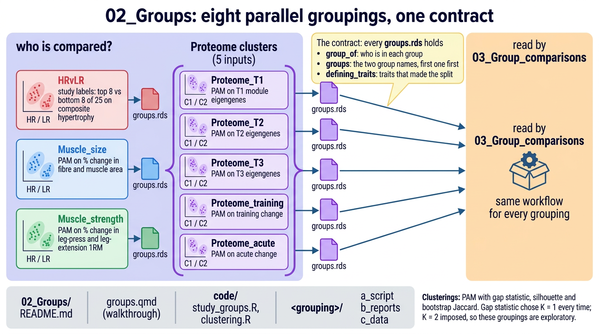

# 02_Groups

Decides who is compared, before any comparison runs. Eight parallel groupings, each written as one
`<grouping>/c_data/groups.rds` that every step in `03_Group_comparisons` reads the same way:

| Grouping | Groups | Defined by |
|---|---|---|
| `HRvLR` | HR, LR | the study: top and bottom 8 of 25 on the composite hypertrophy score |
| `Muscle_size` | HR, LR | PAM on % change in fibre and muscle area; reproduces HR/LR |
| `Muscle_strength` | HR, LR | PAM on % change in leg-press and leg-extension 1RM |
| `Proteome_T1`, `_T2`, `_T3` | C1, C2 | PAM on the module eigengenes at that time point |
| `Proteome_training`, `_acute` | C1, C2 | PAM on the change in module eigengenes over training or the bout |



The gap statistic picks K = 1 for every clustering: the data hold no natural groups. K = 2 is
imposed on purpose, so every clustered comparison downstream is exploratory.

## Scripts

| Script | Does |
|---|---|
| `code/study_groups.R` | checks the composite score and writes the HR/LR labels |
| `code/clustering.R` | PAM, gap statistic, silhouette and bootstrap Jaccard for one grouping |
| `<grouping>/a_script/run_groups.R` | renders the grouping's script with `grouping` set |

The logic lives once in `code/`. Each script is also its report: Quarto renders it, prose and
output together, to `<grouping>/b_reports/<script>.pdf`.

## Inputs

| File | Holds |
|---|---|
| `00_Setup/Input/phenotype.csv` | per-person size, strength, composite score and volume |
| `00_Setup/Input/metadata.csv` | run to person and label (HRvLR only) |
| `01_Processing/06_Module_Building/c_data/modules.rds` | module eigengenes (proteome groupings only) |

## Run

From the project root:

```sh
Rscript run_all.R 02_Groups                          # every grouping
Rscript 02_Groups/Proteome_T1/a_script/run_groups.R  # one grouping
```

## Outputs

| File | Holds |
|---|---|
| `<grouping>/c_data/groups.rds` | `group_of` (person to group), `groups` (the two groups, first one first), `defining_traits` |
| `<grouping>/c_data/clustering.xlsx` | K choice and reason, diagnostics, stability, assignments, cluster space |
| `HRvLR/c_data/study_groups.xlsx` | the recomputed composite and the labels |
| `<grouping>/b_reports/*.pdf` | the rendered script |
