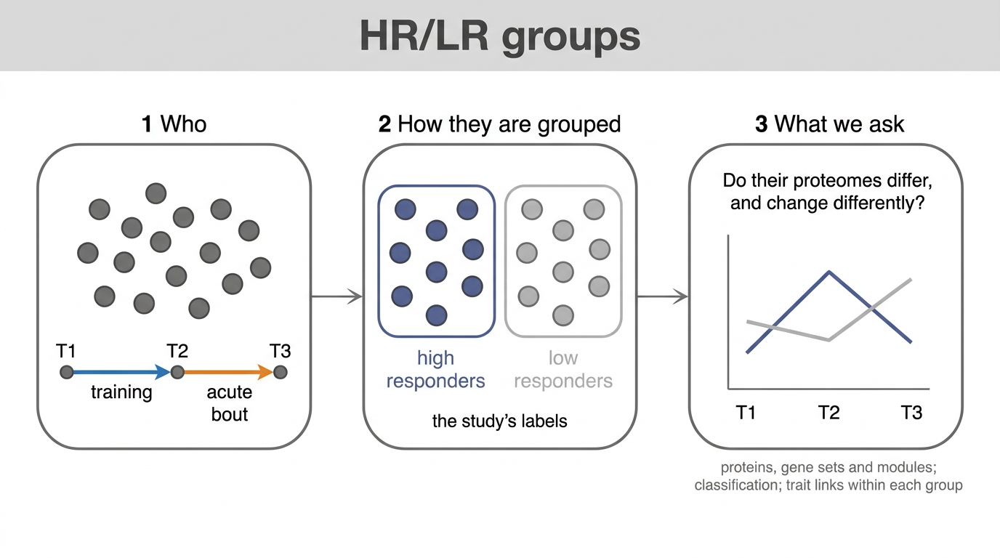

# 02 · HRvLR groups

The study's own split: High and Low Responders, the median split of the composite hypertrophy
score, eight subjects each. The composite tracks fibre-area change (Spearman 0.90) far more than
strength gain (0.11), so a fibre-area difference between the groups is built in.

| Substage | Asks | Method |
|---|---|---|
| [`01_Design_Contrasts`](01_Design_Contrasts/README.md) | which comparisons | six cell means, blood covariate, subject blocked; nine contrasts |
| [`02_Protein_Contrasts`](02_Protein_Contrasts/README.md) | which proteins change, per contrast | limpa `dpcDE`, limma `eBayes(robust)`, logFC with 95% CI; PCA and PERMANOVA; fry concordance |
| [`03_Set_Contrasts`](03_Set_Contrasts/README.md) | which gene sets shift, per contrast | fgsea and fry |
| [`04_Module_Contrasts`](04_Module_Contrasts/README.md) | which modules shift, per contrast | eigengene limma, fry on members |
| [`05_Module_Preservation`](05_Module_Preservation/README.md) | are each group's modules found in the other | WGCNA `modulePreservation` |
| [`06_Classification`](06_Classification) | does one feature separate the groups | Wilcoxon AUC with DeLong and bootstrap CIs, at protein, set and module level |
| [`07_Trait_Associations`](07_Trait_Associations/README.md) | does a phenotype link differ by group | Spearman within group; limma `feature ~ group * trait` |
| [`Figures/`](Figures) | Figures 1 to 3 and supplements S01 to S03 | saved outputs only |

The interaction contrasts are the direct test of a group difference in response. A feature
significant in one group and not the other is not, on that basis, a group difference.
