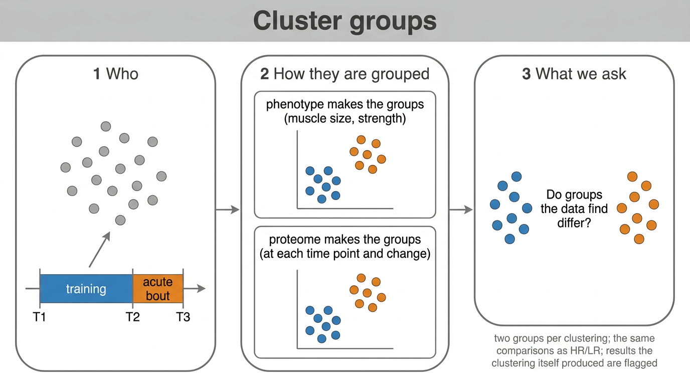

# 03 · Cluster groups

Groups found by clustering people, three ways, each a self-contained sub-pipeline.

| Sub-pipeline | Clustered on | Then |
|---|---|---|
| [`Muscle_size`](Muscle_size) | % change in fibre area (mixed, type I, type II) and mCSA | the HR/LR template on the clusters |
| [`Muscle_strength`](Muscle_strength) | % change in leg-press and leg-extension 1RM | the HR/LR template on the clusters |
| [`Proteome`](Proteome) | module eigengenes at T1, T2, T3, training change and acute change | the HR/LR template once per input, each row tagged circular, caution or clean; phenotype tests |

## Choosing K

Every clustering uses PAM and the same diagnostics, fixed before any proteome result is read: the
gap statistic for K = 1 to 3 with the one-standard-error rule of Tibshirani, Walther & Hastie
(2001), mean silhouette for K = 2 and 3, group sizes, and bootstrap Jaccard stability per cluster
(`fpc::clusterboot`, Hennig 2007). The fpc guidance reads a mean Jaccard of 0.75 or more as a
stable cluster, 0.6 to 0.75 as a pattern with doubtful membership and below 0.6 as untrustworthy.

The gap statistic selects K = 1, no grouping, for size, strength and the proteome at every input.
That result is reported in each `01_Clustering` workbook. K = 2 is then imposed for each, with the
reason recorded in `imposed_reason`, so the exploratory comparisons can run:

- size: K = 2 reproduces the HR/LR split exactly, so `Muscle_size` repeats that comparison;
- strength: K = 2 is stable (Jaccard 0.84 and 0.88) and cuts across HR/LR; HR_S22 has no
  leg-extension 1RM and stays unassigned;
- proteome: K = 2 splits are mostly unstable (Jaccard 0.56 to 0.86) and do not track HR/LR.

## How the phenotype sub-pipelines reuse the HR/LR code

`01_Clustering` writes relabelled copies of the trunk's inputs to `c_data/inputs/`: the clusters
become groups `Hi` and `Lo` (by the mean of the family's first trait), and any unassigned
subject's samples drop out. The stages from `02_Design_Contrasts` on are copies of the HR/LR stages that read
those inputs, with HR and LR renamed Hi and Lo. A fix to one copy has to be made in all three.

The proteome sub-pipeline runs the same template once per clustering input, on clusters C1 and C2,
and tags every comparison by whether it reuses the time points the clustering was built from
(`Proteome/README.md`). `08_Cluster_Phenotype` tests size and strength, which played no part in the
clustering.
