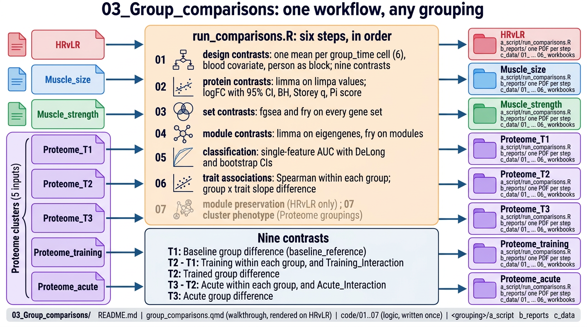

# 03_Group_comparisons

How do two groups of people differ? The same analyses run, in parallel, for all eight groupings
from `02_Groups`: HRvLR, Muscle_size, Muscle_strength and the five proteome clusterings. Each
analysis is written once in `code/`; each grouping folder holds a runner, its reports and its
results.



## Scripts

| Script | Does | Writes to `<grouping>/c_data/` |
|---|---|---|
| `code/01_design_contrasts.R` | cell-means model with blood and person block; nine contrasts and their roles | `01_design.rds`, `01_design_contrasts.xlsx` |
| `code/02_protein_contrasts.R` | limma on limpa values: logFC with 95% CI, BH, Storey q, Π; fry concordance; PCA and PERMANOVA | `02_fit.rds`, `02_protein_contrasts.xlsx` |
| `code/03_set_contrasts.R` | fgsea and fry on every gene set; fgsea collapse | `03_set_tests.rds`, `03_set_contrasts.xlsx` |
| `code/04_module_contrasts.R` | limma on eigengenes, fry on modules, membership against protein change | `04_module_contrasts.xlsx` |
| `code/05_classification.R` | single-feature AUC with DeLong and bootstrap intervals, five tasks, three feature types | `05_{protein,set,module}_classification.xlsx` |
| `code/06_trait_associations.R` | Spearman within each group; limma group × trait slope difference | `06_trait_associations.xlsx` |
| `code/07_module_preservation.R` | HRvLR only: WGCNA preservation of each group's modules in the other | `07_module_preservation.xlsx` |
| `code/07_proteome_clusters.R` | `Proteome_clusters` only: do the proteome clusters differ in size or strength? Then every proteome result stacked | `07_cluster_phenotype.xlsx`, `*_all_inputs.xlsx` |

Each script is also its report: Quarto renders it, prose and output together, to
`<grouping>/b_reports/<script>.pdf`. Steps run in order; each reads the design (`01`), and sets and
modules also read the protein fit (`02`).

`Proteome_clusters` reads the five proteome groupings. Its stacked workbooks carry an `input` column
and a `validity` column: `circular` when a comparison uses exactly the time points the clustering was
built on, `caution` when it shares one, `clean` otherwise.

Every clustering found K = 1 (no natural groups); K = 2 was imposed, so every clustered comparison
is exploratory. HR and LR are extreme groups (top and bottom 8 of 25), so growth differences between
them are built in.

## Inputs

`02_Groups/<grouping>/c_data/groups.rds`, and the `01_Processing` outputs: `proteins.rds`,
`DAList_limpa.rds`, `DAList_corrected.rds`, `gene_sets.rds`, `singscore.rds`, `modules.rds`; plus
`00_Setup/Input/phenotype.csv`.

## Run

From the project root:

```sh
Rscript run_all.R 03_Group_comparisons                          # every grouping
Rscript 03_Group_comparisons/HRvLR/a_script/run_comparisons.R   # one grouping
```

## Outputs

`<grouping>/b_reports/NN_<step>.pdf`, one per step, and `<grouping>/c_data/`, the files in the table
above. Every workbook opens with `read_me` and `columns` and closes with `input_manifest` and
`package_versions`.
