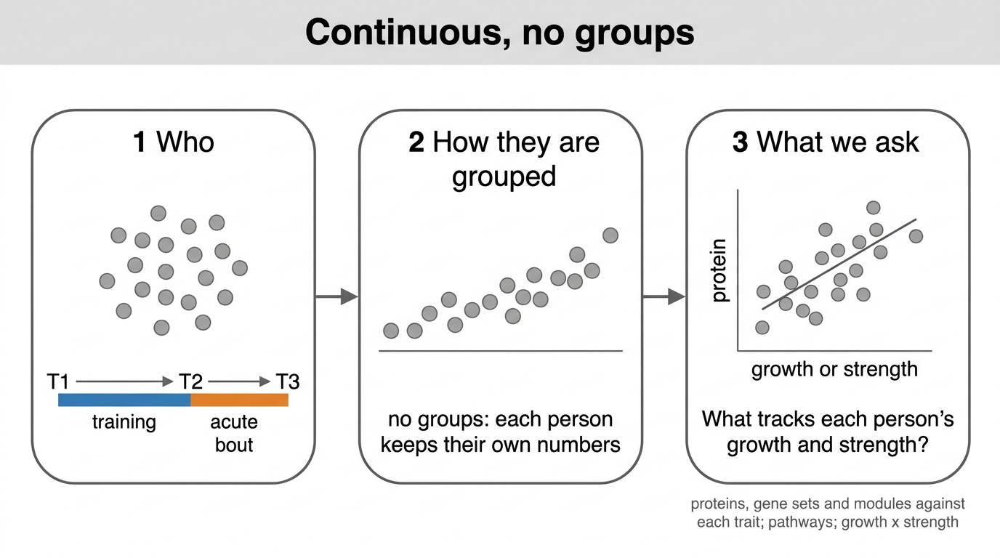

# 04 · Continuous, no group

Every subject pooled and each trait kept as a number, so nothing is lost to a split.

| Substage | Asks | Method |
|---|---|---|
| [`01_Associate`](01_Associate) | which proteins, set scores and modules track each trait | limma on one value per subject, Spearman and bicor beside it; the sample model; growth + strength and growth x strength |
| [`02_Pathways`](02_Pathways/README.md) | which gene sets lead each trait's protein ranking | fgsea and cameraPR on the limma t |
| [`04_Profile_Clusters`](04_Profile_Clusters/README.md) | which proteins share a pattern of trait links | hierarchical clustering of association profiles; ORA per group |

Pairings: training change, T1 level and acute change against the % trait changes; T1 and T2
levels against the trait levels at the same biopsy; and the T3 level against the T2 trait levels,
since T3 follows the same training. T3 also carries the bout's acute effect.

Growth x strength asks whether a feature's link to strength gain depends on how much the person
grew: `feature ~ growth * strength`, where growth is the composite and strength a 1RM gain. It is
fitted in `01_Associate` (sheet `interaction`).
