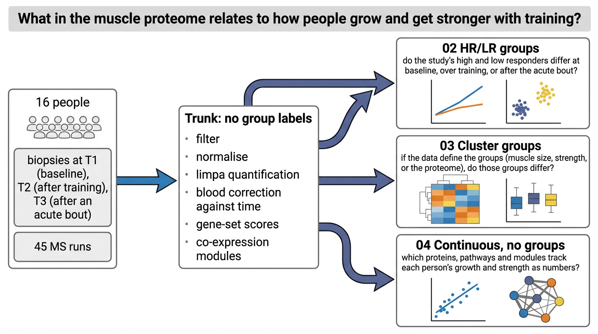

# HRvLR Proteomics



DIA mass-spectrometry proteomics of skeletal muscle from a resistance training study. Sixteen
subjects were biopsied at baseline (T1), after the training programme (T2) and after an acute bout
at the end of it (T3). 48 MS runs; three fail on depth (44 to 68% missing) and are dropped,
leaving 45.

The study labelled each subject a High or Low Responder (HR, LR) by a median split of a composite
hypertrophy score, eight each. That split is mostly a fibre-area split, so the project asks its
questions three ways: with those labels, with groups formed by clustering, and with no groups at
all.

## Layout

| Folder | Holds | Groups |
|---|---|---|
| [`00_Input/`](00_Input/README.md) | study data, no code | |
| [`01_Trunk/`](01_Trunk/README.md) | filtering, normalisation, limpa, gene sets and scores, modules: everything every arc reads | none |
| [`02_HRvLR_groups/`](02_HRvLR_groups/README.md) | the study's HR/LR split | HR, LR |
| [`03_Cluster_groups/`](03_Cluster_groups/README.md) | groups found by clustering people on size, on strength, or on their proteome | clusters |
| [`04_Continuous_no_group/`](04_Continuous_no_group/README.md) | every subject pooled, each trait a number | none |

The trunk uses no group label: blood is corrected against time point only, and the modules are
built on subject-centred abundance. Each arc reads only `00_Input/` and `01_Trunk/`, never another
arc. Within an arc, data passes through disk, so a substage reruns alone once its inputs exist.

Every substage holds `a_script/` (one script), `b_reports/` (a PDF), `c_data/` (one workbook,
plus any `.rds` a later substage reads) and a README naming what it reads and writes. Every
workbook opens on `read_me` and ends with `input_manifest` (inputs with md5) and
`package_versions`.

Shared code lives in `R/`: `helpers.R` (blood correction, limpa and limma fits, ANCOVA, Spearman
via `cor.test`, Storey's q, phenotype tables, heatmap and workbook plumbing), `classify.R` and
`associate.R` (single-feature classification for the group arcs, and the continuous association
step), `figure_theme.R` and `figure_panels.R` (figures).

## Run

```sh
Rscript -e 'renv::restore()'
Rscript run_all.R            # every substage in order; logs in .runlogs/
Rscript run_all.R 01 02      # the trunk and the HR/LR arc
```

`00_Input/README.md` has the download command for the STRING files `01_Trunk/07_Characterise`
reads.

## Statistical conventions

- Missing values: limpa (Li, Cobbold & Smyth 2025) fits a detection probability curve and gives
  every protein a value in every sample (`dpcQuantByRow`). Protein contrasts use `dpcDE` with the
  standard errors as precision weights. Every other test reads that complete matrix; protein rows
  carry `observed_share`, the share of values measured rather than estimated.
- Blood: an index (mean log2 HBB and HBA1 against the sample median) enters every limma model as a
  covariate. Tests that take no covariate read a copy with each protein's blood slope removed
  (`limma::removeBatchEffect`, design = time point).
- Subjects: HR and LR are different people, so subject is a random block in sample-level models;
  change scores carry one value per subject.
- Results are reported as each package returns them: effect, test statistic, nominal p and the
  package's own BH (fgsea, fry, limma), with Storey's q beside BH where a step adds it. Nothing is
  gated on a threshold, and no shuffle or leave-one-out procedure sits on top.
- Identifiers: proteins by `uniprot_id`, gene sets by `set_id`, modules by colour; every result
  table carries them as `feature`, with a readable `label`. Module colours are assigned by WGCNA
  on each build and change when the trunk changes.

## Limits stated rather than tested

- Biopsy composition: a needle biopsy holds a varying share of fibre, connective tissue and fat.
  Large co-moving sarcomere changes could partly reflect that share; no covariate adjusts for it.
- Composite formula and biopsy timing (programme length, time from bout to T3) are not in the
  repository.

## Dependencies

`renv.lock` pins every package. Two come from outside CRAN and Bioconductor's current releases:
`enrichVolcano` (GitHub commit `d3fed631f4`, which the HR/LR volcano supplement uses) and `DGCA`
(GitHub, `andymckenzie/DGCA`, archived from CRAN).

## Version 1 is the tag legacy-v1

The first version of this project, with its prediction screen (F06), `functions/`, `tests/` and
`archive/`, is the git tag `legacy-v1`.
