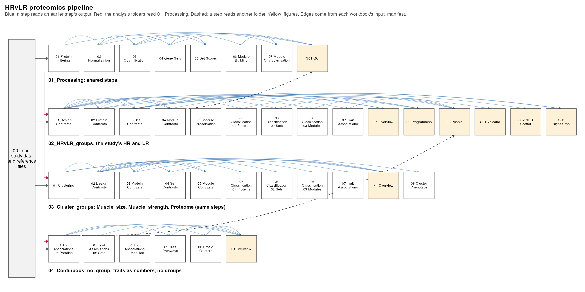

# HRvLR Proteomics

DIA mass-spectrometry proteomics of skeletal muscle from a resistance-training study. Sixteen
people were biopsied before training (T1), 96 h after the last of 16 sessions (T2), and 24 h after
one further standardised session (T3). Of 48 runs, 45 pass quality control, and 1,900 of 2,400
proteins are analysed.

Twenty-five people trained. The study ranked them on a composite hypertrophy score,
(2 × %ΔmCSA + %ΔfCSA) / 3, and profiled the top eight as higher responders (HR) and the bottom
eight as lower responders (LR); the middle nine were not profiled. The repository asks its
questions three ways: with those groups, with groups found by clustering, and with no groups at
all.



## Folders, in run order

| Folder | Holds |
|---|---|
| [`00_Setup`](00_Setup/README.md) | study inputs and the helpers every walkthrough sources |
| [`01_Processing`](01_Processing/README.md) | filtering, normalisation, limpa quantification, gene sets, set scores, modules |
| [`02_Groups`](02_Groups/README.md) | who is compared: HR/LR, and clusters on size, strength and the proteome |
| [`03_Group_comparisons`](03_Group_comparisons/README.md) | how two groups differ: contrasts, sets, modules, classification, trait links |
| [`04_Continuous_no_group`](04_Continuous_no_group/README.md) | everyone pooled, each trait a number |
| `05_Figures` | figures drawn from saved results only |

## Every step

Each analysis is one Quarto walkthrough: it loads packages, reads its inputs, checks them, runs
the analysis, validates the result, summarises and saves, explaining each step beside the code.

```
NN_Step_Name/
├── a_script/     the walkthrough (.qmd)
├── b_reports/    the rendered walkthrough (.html), and figure PDFs
└── c_data/       workbooks, plus any .rds a later step reads
```

Walkthroughs shared by several groupings sit in their phase's `a_script/` and are rendered once
per grouping into `<grouping>/<NN_Step>/`. Every workbook opens with `read_me` (one line per
sheet) and `columns` (every column defined, from `00_Setup/Shared_functions/workbook_columns.csv`),
and closes with `input_manifest` (every file read, with its md5) and `package_versions`. A step
reads only files earlier steps saved, so any step reruns alone.

## Run

```sh
Rscript -e 'renv::restore()'
Rscript run_all.R                       # every step in order
Rscript run_all.R 01_Processing 02      # steps whose path starts with these prefixes
```

Run from the project root, so Quarto's R sessions start with the project's renv library. The
runner stops at the first failure; logs go to the untracked `Scratch/runlogs/`. Every reference
file sits in the `references/` folder of the step that reads it; nothing downloads at run time.
Random steps are seeded.

## Terms

| Term | Meaning here |
|---|---|
| contrast | one comparison of group means, e.g. `Training_HR` (HR's T2 minus T1) or `Training_Interaction` (HR's training change minus LR's) |
| logFC, `_lower`, `_upper` | the contrast on the log2 scale (+1 is twice as much) and its 95% interval; every estimate's interval is named after it (`slope_lower`, `rho_upper`) |
| `p`, `fdr`, `qvalue` | nominal p; Benjamini-Hochberg within the screen the sheet names; Storey's q over the same screen |
| Π | p^\|logFC\| (Xiao et al. 2014), the manuscript's nominal score |
| limpa | gives every protein a value and a standard error in every biopsy from a detection-probability curve, so missing values are modelled rather than filled |
| fgsea, fry | two gene-set tests: fgsea asks whether a set ranks high against other proteins; fry asks whether its proteins move consistently across people |
| module, eigengene, kME | a WGCNA group of co-varying proteins, its one-number summary per biopsy, and a protein's correlation with that summary |
| singscore | one score per gene set per biopsy, from the set's rank within that biopsy |
| AUC | the chance a random person from the first group has a higher value than one from the second |
| floor | the baseline contrast: the groups come from an outcome, so a T1 difference shows how far the split separates people before training |

## Conventions

- Blood: an index (mean log2 HBB and HBA1 against the sample median) is a covariate in every
  limma model. Tests that take no covariate read a copy with each protein's blood slope removed
  against time point only.
- People: each person gives up to three biopsies, so person is a random block in biopsy-level
  models; change scores carry one value per person.
- Reporting: nothing is filtered on a threshold before it is written. Reports draw at most 12 to
  24 features per screen; the workbooks keep every row.
- Identifiers: proteins by UniProt accession, gene sets by `collection|name`, modules by colour.
  Module colours change if `01_Processing` is rebuilt.

## Limits

- A needle biopsy holds a varying share of fibre, connective tissue and fat; no covariate adjusts
  for it.
- Removing each protein's blood slope raises, rather than lowers, the blood correlation of the 85
  proteins measured in 20 or fewer runs (`01_Processing/03_Quantification`). Every method that
  reads the blood-corrected matrix inherits this; the fix is pending.

## Dependencies

`renv.lock` pins every package the code loads. `enrichVolcano` comes from GitHub, pinned to commit
`d3fed631f4`.
